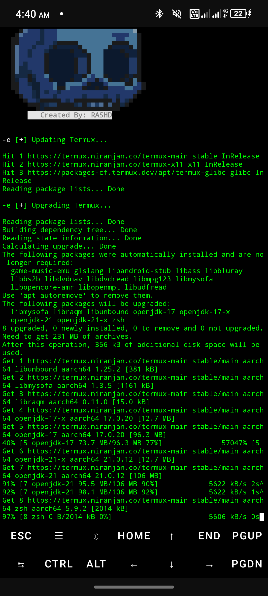
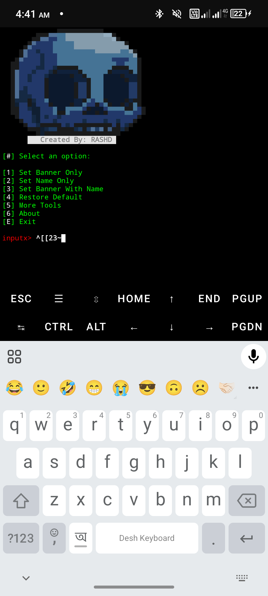
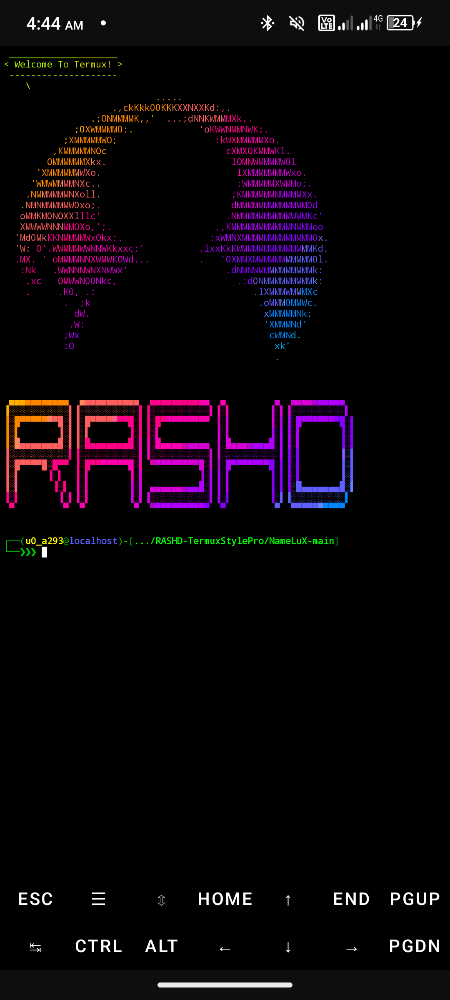
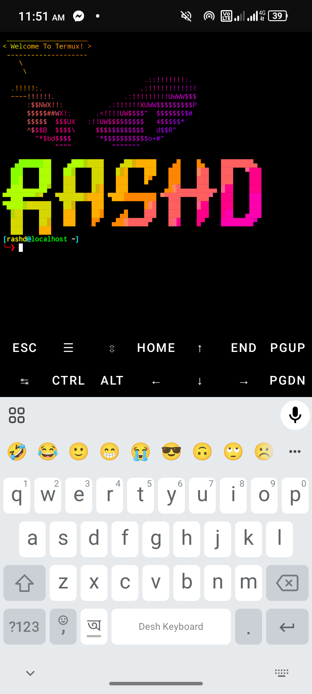

<h1 align="center">RASEL V1</h1>

<p align="center">
  
  
  
  
  
</p>

RASEL V1 is a Python3 tool for customizing Termux with unique banners, PS1 prompts, fonts, and hacker-style animations.

## Features

- **270+ Font Designs** for figlet banners
- **70+ Banner Styles** (cowsay + unique art)
- **30 PS1 Prompt Styles**
- **21 Input Text Colors**
- **3D Animations & Hacker Theme**
- **Auto-Suggestions & Syntax Highlighting** (Zsh)

## Installation (Termux)

```bash
pkg update && pkg upgrade
pkg install git python
git clone https://github.com/cyberrasel999/Rasel-Termux-Style-Pro.git
cd Rasel-Termux-Style-Pro
bash setup.sh
python RASEL-V1.py
```

Setup backs up your current figlet fonts and cowsay banners to `~/.rasel-style-backup/` before installing the new set.

## Usage

Run the tool and choose from the menu:

1. **Set Banner Only** – Choose a cowsay banner + prompt style + color
2. **Set Name Only** – Display your name in figlet font
3. **Set Banner With Name** – Combine banner + name + prompt
4. **Restore Default** – Reset Termux to original look
5. **More Tools** – Other repositories
6. **About** – Tool info

## Screenshots

> Note: the screenshots below are from the previous version. The new RASEL logo and menu are shown in the preview.

<p align="center">
  
  
</p>
<p align="center">
  
  
</p>

## Contact

- Telegram: [t.me/GCSF_CYBER_RASEL](https://t.me/GCSF_CYBER_RASEL)
- GitHub: [github.com/cyberrasel999](https://github.com/cyberrasel999)
